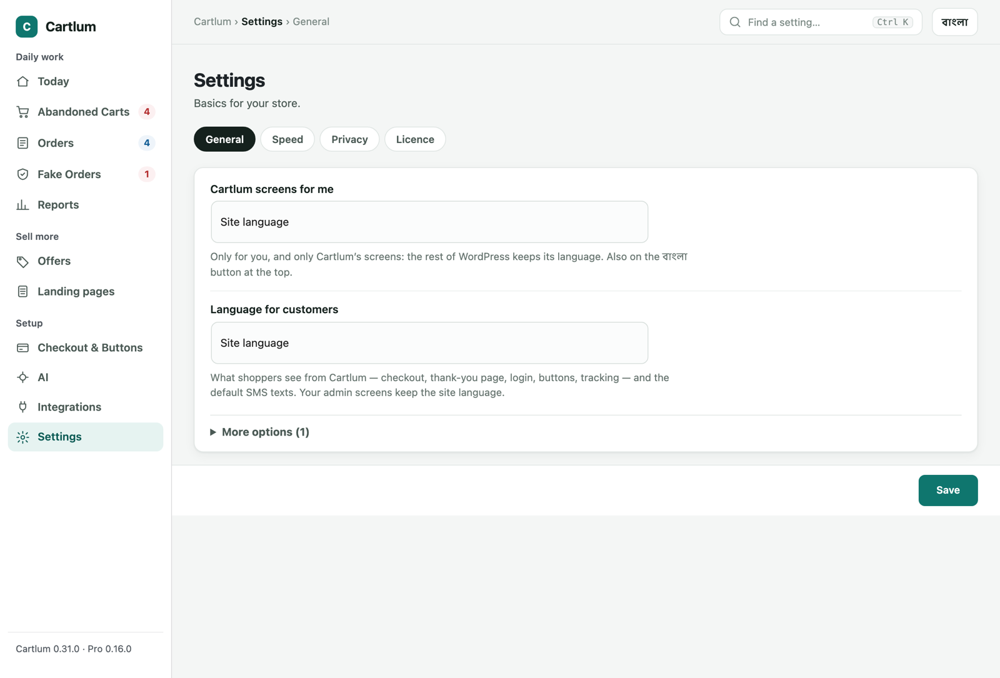

# Cartlum – Abandoned Cart Recovery for WooCommerce

Most abandoned-cart plugins send an email. In many markets customers check out with a phone number and never read email, so the cart is lost. **Cartlum is built phone-first**: it saves the cart the moment a phone number is typed at checkout, then helps you win it back by SMS, phone call, WhatsApp and email.

## Download

**[⬇ Download the latest version](https://github.com/Claudefarid/cartlum-free/releases/latest)**: on the release page, download the file named `cartlum-x.y.z.zip`. Don't use "Source code".

## Install

1. In WordPress, go to **Plugins → Add New → Upload Plugin**.
2. Choose the `cartlum-x.y.z.zip` file you downloaded and click **Install Now**, then **Activate**.
3. Open **Cartlum** in the admin menu and follow **Set up Cartlum** (5 minutes). Under **Integrations → SMS**, choose your SMS gateway (eSMS, BulkSMSBD, SSL Wireless, Alpha SMS, MiMSMS, Twilio or any HTTP SMS API) and send yourself a test SMS.

To update, upload the new zip the same way and choose **Replace current with uploaded**. Your settings and carts are kept.

Requires WordPress 6.2+, WooCommerce 8.0+ and PHP 7.4+.

## Features

- **Saves the cart as the phone number is typed**: classic checkout, block checkout and CartFlows.
- **Save-cart popup**: asks for the number when a shopper is about to leave, or after "Add to cart".
- **Phone-first checkout**: mobile number first; Bangla digits accepted; your delivery and refund note above the order button.
- **Buy now**, plus **WhatsApp** and **Call to order** buttons.
- **Option buttons**: colours and sizes as buttons instead of drop-down lists, with sold-out choices crossed out.
- **Sell through AI assistants**: ChatGPT, Gemini, Claude, Grok, Perplexity and Kimi can read your shop (`/llms.txt`, a product feed, delivery and return times in each product's data) and send buyers straight to your checkout with an order link. Orders from AI assistants are counted in Reports.
- **Order again**: one tap puts an earlier order back in the cart with the checkout already filled in, from My Account or from `{reorder_link}` in an SMS.
- **SMS, WhatsApp, email and calls**:
  - one-tap restore links and one-time coupons;
  - designed reminder emails;
  - an automatic reminder with quiet hours and a test mode.
- **Fake-order protection**:
  - blocks numbers, IP addresses (and ranges) and devices;
  - repeat-order limits;
  - an SMS code for risky cash-on-delivery orders;
  - a Fake Orders page.
- **Orders to confirm**: every new order in one list with call and WhatsApp buttons and one-tap answers (confirmed, no answer, call back, cancel, fake).
- **Order SMS and tracking**, **review requests by SMS** (answers become verified-owner reviews), and a phone-number login for My Account.
- **Honest reports**: money recovered (compared with the period before), what works per channel, the most-abandoned products, and where every order ended up (delivered, returned, cancelled, fake).
- **CSV export**, and **webhooks** for Zapier, Make and Pabbly.
- **A clean admin built around your day**: Today (what needs you now), every feature's status at a glance, all integrations in one place, Ctrl+K search, a 5-minute setup and a বাংলা button.
- **Bangla included.**

Want more? See [Cartlum Pro](#cartlum-pro) below.

## Built around your day

Cartlum's admin is organised by a shop's daily work: **Today · Abandoned Carts · Orders · Fake Orders · Reports · Checkout & Buttons · Integrations · Settings**, plus **Offers**, **Landing pages** and **AI** with Pro.

- **Today** opens with what needs you now, each job with its button: carts to call, orders to confirm, parcels to send, risky orders, cancellations without a reason. Then the period's results as cards with trends, money recovered per day, who to contact, what works and the most-abandoned products. **Your features** shows every feature as On, Off or Needs setup.
- **Integrations** keeps every outside service in one place (SMS, Steadfast, Pathao, RedX, Paperfly, Facebook, FraudBD, WhatsApp, ElevenLabs, AI, webhooks), each with its status, keys and a test button.
- **Find a setting** (Ctrl K / ⌘ K) on every screen jumps straight to any option.
- **Simple settings:** switches and plain words, with technical options under **More options**. The **Save** bar saves without reloading, and Cartlum warns before you leave with unsaved changes.
- **Set up Cartlum in 5 minutes:** a step-by-step first setup.
- **বাংলা button:** Cartlum's screens in Bangla, for you only.
- **Works on a phone:** the menu becomes a strip at the top.

| Integrations | Find a setting |
|---|---|
|  |  |
| **Settings with switches** | **Today on a phone** |
|  |  |

## What your customers see

| Product page buttons | Colours as buttons | Save-cart popup |
|---|---|---|
|  |  |  |
| **Phone-first checkout** | **Log in with a phone number** | **Order again** |
|  |  |  |
| **Order tracking** | **Review request** | **Reminder email** |
|  |  |  |

## Cartlum Pro

Cartlum Pro is a paid add-on. It installs next to the free plugin and adds:

| | Free | Pro |
|---|:---:|:---:|
| Save carts at checkout and with the popup | ✅ | ✅ |
| SMS, WhatsApp, email and call from each cart | ✅ | ✅ |
| One automatic reminder | ✅ | ✅ |
| **Multi-step reminders**: as many steps as you like, each with its own time, channel and message | | ✅ |
| **A/B tests**: two versions of a message; the winner is shown | | ✅ |
| **Smart coupons**: a discount only when it helps (not for loyal or risky customers) | | ✅ |
| **Automatic WhatsApp** through Meta's WhatsApp Cloud API | | ✅ |
| **AI call**: an AI voice agent calls the customer in Bangla over your own phone line and reports back | | ✅ |
| **AI message writer**: drafts SMS in English, Bangla or Banglish | | ✅ |
| **Win-back SMS** to past buyers who haven't ordered for a while | | ✅ |
| Fake-order protection: blocklist, limits, SMS code for risky orders | ✅ | ✅ |
| **Courier check**: each customer's delivered and refused parcels at Steadfast, Pathao, RedX and Paperfly | | ✅ |
| **Advance payment**: bKash / Nagad Send Money with Transaction ID before cash-on-delivery orders | | ✅ |
| **Couriers: Steadfast, Pathao, RedX, Paperfly**: send parcels from WooCommerce (one, bulk or automatic); delivery status updates by itself | | ✅ |
| **Facebook Pixel and Conversions API**: no double counting, customer details hashed; for cash on delivery, a purchase counts only if the order isn't cancelled | | ✅ |
| **Bundle offers** on product pages, and a **customer score** on every cart | | ✅ |
| **Quantity offers**: "Buy 2, save ৳100" and "Buy 1, get 1 free", applied in the cart by themselves | | ✅ |
| **Recommendations**: "Customers also bought" under each product, learned from your own orders; the upsell can pick its product from them | | ✅ |
| **Upsell after the order**: one tap adds a product to the same cash-on-delivery order and parcel; a second offer if they say no | | ✅ |
| **Loyalty points**: earned when an order is delivered, spent at checkout after phone login | | ✅ |
| **Gift cards**: sold as a product or given by hand, code by SMS, balance kept on the card | | ✅ |
| **Product landing pages**: a one-product page for your ads with the checkout on the same page | | ✅ |
| **Customers confirm their own order** from a link in the "order received" SMS | | ✅ |
| **Staff phone app**: orders to confirm and carts to call, with new-order notifications | | ✅ |
| **Cartlum fraud network**: how a number did at other shops (hashed, opt-in) | | ✅ |
| **Reports by district and by product** | | ✅ |
| Updates and support with a licence key | | ✅ |

Each Pro feature connects with the store's own accounts (SMS gateway, ElevenLabs, FraudBD, Meta). You pay those services directly; Cartlum adds nothing on top.

### Sell more on every order

| Landing page for your ads | Its order form | Offer after the order |
|---|---|---|
|  |  |  |

- **Landing pages** (`/lp/<name>/`): headline, photos, video, benefits, reviews and questions, then your real checkout on the same page. Cart capture and fake-order protection work there too. Colour and quantity are buttons, and quantity offers show in the total.
- **Upsell after the order**: "Wait! Add this to your order?" One tap adds it to the same cash-on-delivery order, so nothing is charged twice and it ships in the same parcel.

| Customers also bought | Loyalty points at checkout | Staff phone app |
|---|---|---|
|  |  |  |

**Cartlum Pro is coming soon.** To be told when it launches, click **Watch → Custom → Releases** at the top of this page.

## Screenshots

Every screen, by area. Features marked *Pro* need Cartlum Pro.

<b>Abandoned carts</b>

| | |
|---|---|
| **Every saved cart** | **One cart: call, WhatsApp, SMS, history** |
|  |  |
| **Automatic reminders (multi-step: Pro)** | **Message texts** |
|  |  |
| **Save-cart popup** | **Win-back SMS (Pro)** |
|  |  |

<b>Orders</b>

| | |
|---|---|
| **Orders to confirm** | **Order SMS** |
|  |  |
| **Review requests** | **Parcels to couriers (Pro)** |
|  |  |
| **bKash / Nagad advance (Pro)** | **Staff phone app (Pro)** |
|  |  |
| **Customer confirms their order (Pro)** | **Carts to call in the phone app (Pro)** |
|  |  |

<b>Fake orders</b>

| | |
|---|---|
| **Risky orders and cancel reasons** | **Protection: blocklist, limits, SMS code** |
|  |  |
| **Courier check (Pro)** | **Cartlum fraud network (Pro)** |
|  |  |

<b>Reports</b>

| | |
|---|---|
| **Delivery success, money, where orders went (district and product: Pro)** | |
|  | |

<b>Checkout & buttons</b>

| | |
|---|---|
| **Phone-first checkout** | **Buy now, WhatsApp, Call, option buttons** |
|  |  |
| **Phone login and Order again** | **Sell through AI assistants** |
|  |  |

<b>Offers (Pro)</b>

| | |
|---|---|
| **Bundles** | **Quantity offers** |
|  |  |
| **Upsells after the order** | **Recommendations** |
|  |  |
| **Loyalty points** | **Gift cards** |
|  |  |

<b>Landing pages, AI and setup</b>

| | |
|---|---|
| **Landing pages (Pro)** | **AI call (Pro)** |
|  |  |
| **AI writer (Pro)** | **5-minute setup** |
|  |  |

## Licence

GPLv2 or later. See [LICENSE](LICENSE).
