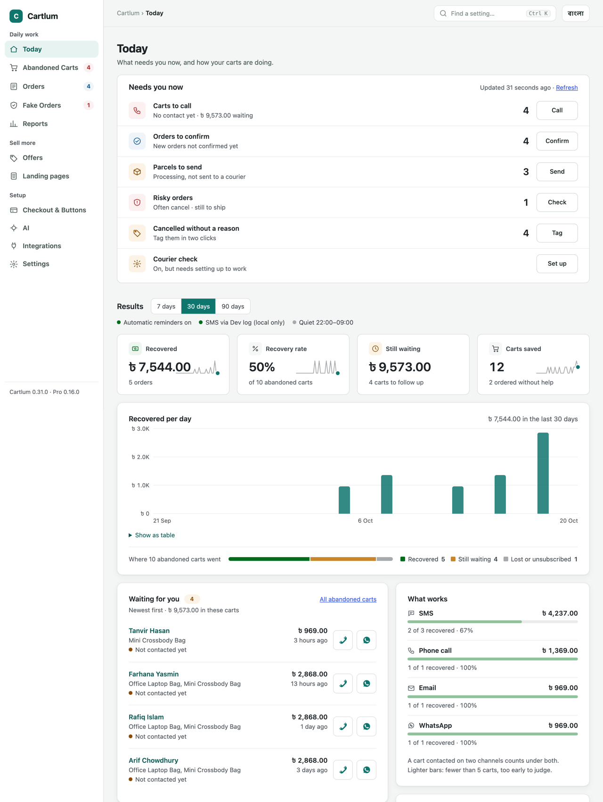
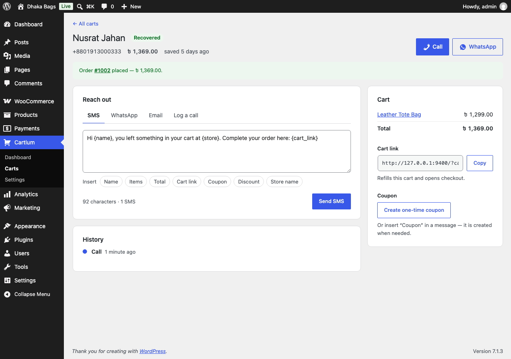
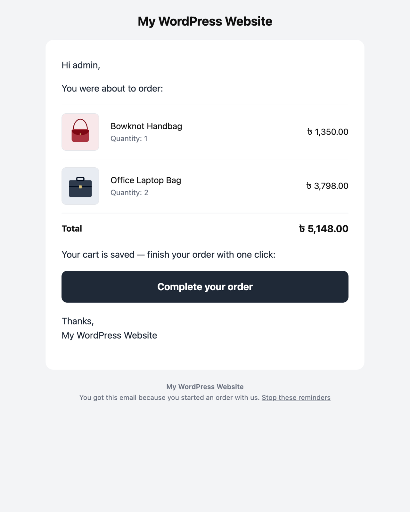

# Cartlum – Abandoned Cart Recovery for WooCommerce

Most abandoned-cart plugins send an email. In many markets customers check out with a phone number and never read email, so the cart is lost. **Cartlum is built phone-first**: it saves the cart the moment a phone number is typed at checkout, then helps you win it back by SMS, phone call, WhatsApp and email.

## Download

**[⬇ Download the latest version](https://github.com/Claudefarid/cartlum-free/releases/latest)**: on the release page, download the file named `cartlum-x.y.z.zip`. Don't use "Source code".

## Install

1. In WordPress, go to **Plugins → Add New → Upload Plugin**.
2. Choose the `cartlum-x.y.z.zip` file you downloaded and click **Install Now**, then **Activate**.
3. Open **Cartlum** in the admin menu. Under **Messages → SMS**, choose your SMS gateway (eSMS, Twilio or any HTTP SMS API) and send yourself a test SMS.

To update, upload the new zip the same way and choose **Replace current with uploaded**. Your settings and carts are kept.

Requires WordPress 6.2+, WooCommerce 8.0+ and PHP 7.4+.

## Features

- **Saves the cart as the phone number is typed**: classic checkout, block checkout and CartFlows.
- **Save-cart popup**: asks for the number when a shopper is about to leave, or after "Add to cart".
- **Phone-first checkout**: mobile number first; Bangla digits accepted.
- **Buy now**, plus **WhatsApp** and **Call to order** buttons.
- **SMS, WhatsApp, email and calls**:
  - one-tap restore links and one-time coupons;
  - designed reminder emails;
  - an automatic reminder with quiet hours and a test mode.
- **Fake-order protection**:
  - blocks numbers, IP addresses (and ranges) and devices;
  - repeat-order limits;
  - an SMS code for risky cash-on-delivery orders;
  - a Fake Orders page.
- **Order SMS and tracking**, and a phone-number login for My Account.
- **Honest reports**: money recovered (compared with the period before), what works per channel, and the most-abandoned products.
- **CSV export**, and **webhooks** for Zapier, Make and Pabbly.
- **Bangla included.**

Want more? See [Cartlum Pro](#cartlum-pro) below.

## Cartlum Pro

Cartlum Pro is a paid add-on. It installs next to the free plugin and adds:

| | Free | Pro |
|---|:---:|:---:|
| Save carts at checkout and with the popup | ✅ | ✅ |
| SMS, WhatsApp, email and call from each cart | ✅ | ✅ |
| One automatic reminder | ✅ | ✅ |
| **Multi-step reminders**: as many steps as you like, each with its own time, channel and message | | ✅ |
| **A/B tests**: two versions of a message; the winner is shown | | ✅ |
| **Smart coupons**: a discount only when it helps (not for loyal or risky customers) | | ✅ |
| **Automatic WhatsApp** through Meta's WhatsApp Cloud API | | ✅ |
| **AI call**: an AI voice agent calls the customer in Bangla over your own phone line and reports back | | ✅ |
| **AI message writer**: drafts SMS in English, Bangla or Banglish | | ✅ |
| **Win-back SMS** to past buyers who haven't ordered for a while | | ✅ |
| Fake-order protection: blocklist, limits, SMS code for risky orders | ✅ | ✅ |
| **Courier check**: each customer's delivered and refused parcels at Steadfast, Pathao, RedX and Paperfly | | ✅ |
| **Advance payment**: bKash / Nagad Send Money with Transaction ID before cash-on-delivery orders | | ✅ |
| **Facebook Pixel and Conversions API**: no double counting, customer details hashed | | ✅ |
| **Bundle offers** on product pages, and a **customer score** on every cart | | ✅ |
| Updates and support with a licence key | | ✅ |

Each Pro feature connects with the store's own accounts (SMS gateway, ElevenLabs, FraudBD, Meta). You pay those services directly; Cartlum adds nothing on top.

**Cartlum Pro is coming soon.** To be told when it launches, click **Watch → Custom → Releases** at the top of this page.

## Screenshots

| Dashboard | A cart |
|---|---|
|  |  |
| **Phone-first checkout** | **Reminder email** |
|  |  |

## Licence

GPLv2 or later. See [LICENSE](LICENSE).
